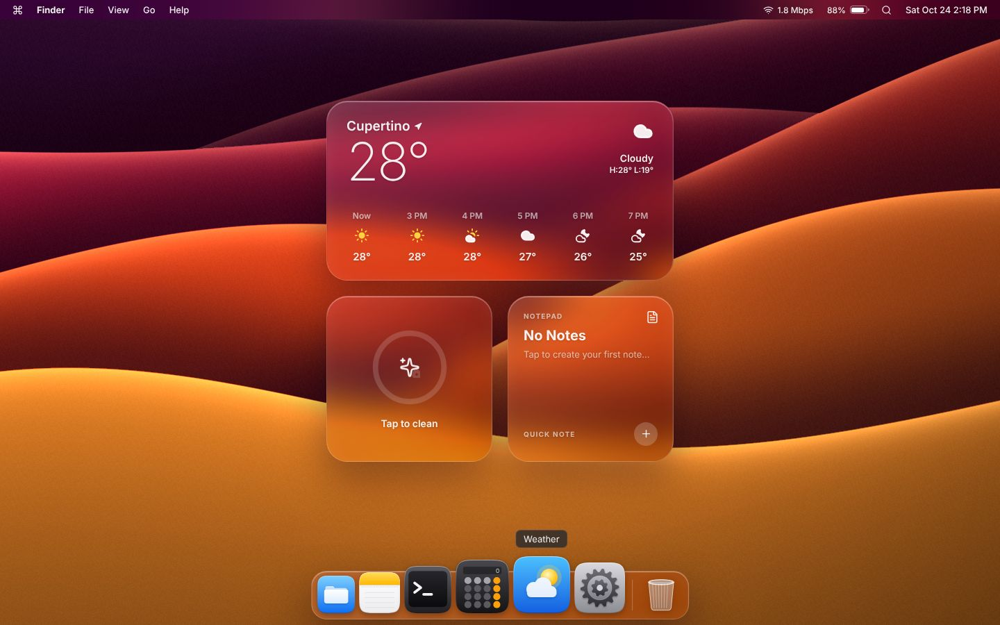

# macOS Desktop in the Browser

A macOS-style desktop built with plain HTML, CSS and JavaScript (no frameworks, no build step),
plus a step-by-step recording script for an ASMR programming video.



## What's inside

- **Live wallpaper**: a WebGL shader paints seven waves of silk with glowing edges, soft
  shadows and film grain. Four colours: Sunset, Ocean, Forest and Lilac.
- **Menu bar**: working menus, the active app's name, your real Wi-Fi speed and battery
  level, Spotlight and a live clock.
- **Frosted glass widgets**: live weather for your city (Open-Meteo, no API key), a cleaner
  with an animated ring, and a notepad that shows your newest note.
- **Dock**: original macOS-style icons that magnify under the mouse, bounce when clicked
  and show a dot for open apps.
- **Windows**: drag, focus, close, minimise into the dock and maximise, with traffic lights.
- **Apps**: Finder, Notes (saved in localStorage), Terminal (`help`, `neofetch`, `weather`,
  `open notes`...), Calculator, System Settings and About This Mac.
- **Spotlight** (⌘K or Ctrl+K): search apps or type a sum like `12 * 7 + 3`.
- **Right-click menu**, notifications and a **boot screen**.

## Run it

Open `desktop/index.html` in Chrome. That's it.

To show your own weather, change `CITY` near the top of the weather section in
`desktop/script.js` (name, latitude and longitude).

## Recording script

`recording-script/index.html` is a teleprompter for the video: 60 steps in 13 chapters. Each
step shows the code to type, where to type it, and a screenshot of what Chrome should show
after you reload. Use the arrow keys to move between steps. It opens with a checklist (VS Code
settings for recording, Chrome full screen) and ends with the video description, chapters,
Shorts ideas and a thumbnail plan.

Three bugs are planned and fixed on camera: a blurry wallpaper, temperatures with decimals,
and a second Finder window.

## Tools

`tools/` checks and rebuilds the recording script:

```sh
cd tools
npm install
node build.mjs          # replay every step, screenshot each run, write the script
node build.mjs --quick  # replay every step and write the script, no screenshots
python3 make_icons.py   # redraw the SVG icons in desktop/icons
```

`build.mjs` starts from four empty files, applies the steps in `plan.mjs` one by one, loads
the page in Chromium after every run step and fails on any JavaScript error, and finally
checks that the result matches `desktop/` byte for byte. It needs Playwright with Chromium
installed.

## Credits

- Icons in the menu bar and widgets: [Lucide](https://lucide.dev) (ISC licence).
- Weather data: [Open-Meteo](https://open-meteo.com) (CC BY 4.0).
- App, folder and file icons in `desktop/icons` are original artwork made for this project.

This is a fan project for learning. It is not affiliated with Apple. macOS is a trademark of
Apple Inc.
